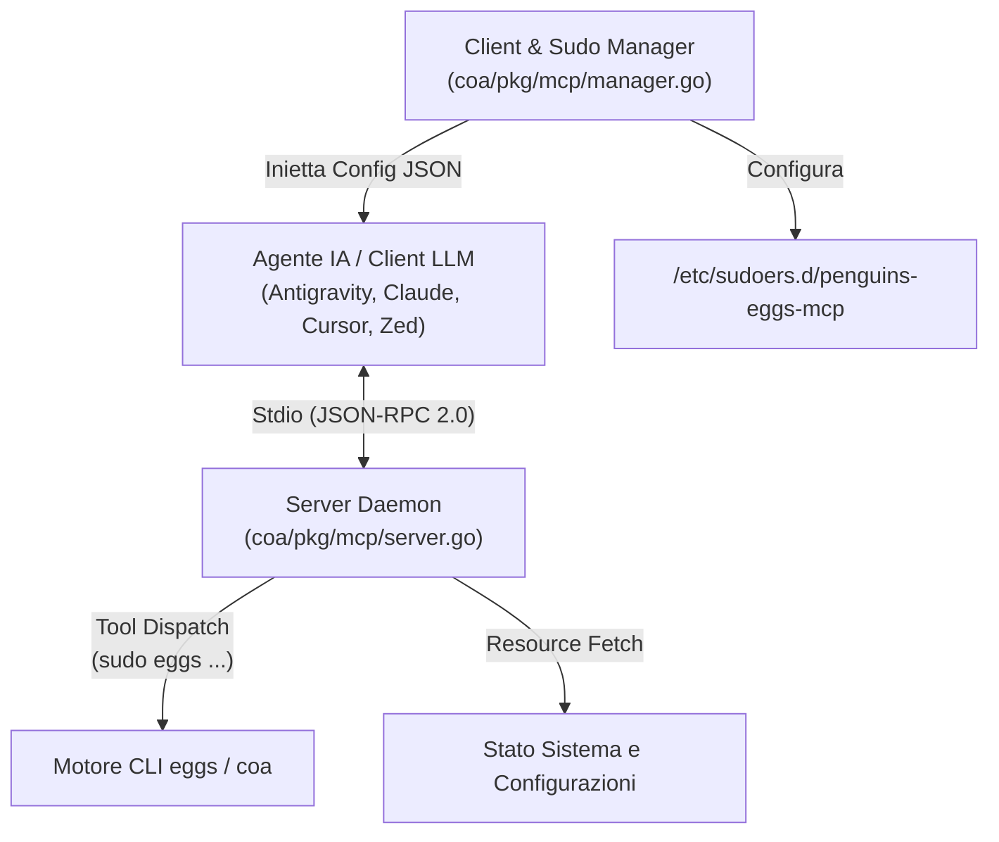

import Translactions from '@site/src/components/Translactions';

<Translactions />

# 🤖 Il server MCP: integrazione nativa con agenti IA

`penguins-eggs` integra nativamente un server **Model Context Protocol (MCP)** all'interno dell'orchestratore Go (`coa/pkg/mcp/`). MCP è lo standard aperto che consente agli assistenti di codifica e agli agenti IA autonomi (**Google DeepMind Antigravity CLI, Claude Desktop, Cursor, Zed, VSCode Roo-Cline**) di scoprire ed eseguire strumenti o leggere risorse di sistema tramite **JSON-RPC 2.0 su Stdio**.

---

## 🏗️ 1. Architettura del modulo (`coa/pkg/mcp/`)



* **`server.go` (Stdio JSON-RPC Daemon):** gestisce il loop `stdin`/`stdout` (disabilitando automaticamente i colori ANSI per non corrompere lo stream JSON) e instrada le chiamate `initialize`, `ping`, `tools/list`, `tools/call`, `resources/list` e `resources/read`.
* **`manager.go` (Client & Sudo Provisioner):** configura `/etc/sudoers.d/penguins-eggs-mcp` (modalità `0440`) per l'esecuzione non presidiata dei comandi autorizzati e aggiorna automaticamente i file JSON dei client IA rilevati preservando l'ownership `UID`/`GID` dell'utente.

---

## 🛠️ 2. I 7 strumenti e le 5 risorse esposte

### Strumenti MCP eseguibili dall'agente (`tools/list`)
* **`eggs_remaster`**: avvia voli di creazione ISO (`clone`, `crypted`, `compression`, `stop_after`, `debug`).
* **`eggs_sysinstall`**: esegue il deployment del sistema (`krill` TUI, `calamares` GUI).
* **`eggs_export`**: trasferisce artefatti verso lo storage Proxmox (`iso`, `pkg`, `log`).
* **`eggs_tools`**: routine di manutenzione (`clean`, `grub40`, `skel`, `build` — quest'ultimo eseguito rigorosamente senza `sudo`).
* **`eggs_destroy`**: pulizia dell'area di lavoro e lazy unmount (`MNT_DETACH`).
* **`eggs_version`**: interroga versione, architettura e commit Git.
* **`eggs_exec`**: esecuzione sicura di argomenti CLI di `eggs`.

### Risorse di sistema ispezionabili (`resources/list`)
* **`eggs://config`** → legge `/etc/penguins-eggs.conf`.
* **`eggs://exclude-list`** → legge `/etc/penguins-eggs.d/custom.exclude.list`.
* **`eggs://version`** → restituisce l'output di `eggs version`.
* **`eggs://status`** → telemetria in tempo reale (`distro.NewDistro()`, `uname -a`, stato live).
* **`eggs://log`** → legge il log centrale `/var/log/penguins-eggs.log`.

---

## 🔧 3. Comandi di gestione e client supportati

```bash
sudo eggs mcp enable   # Configura sudoers e inietta il server MCP nei client IA
eggs mcp status        # Verifica regole sudoers, file JSON dei client e PID attivi
sudo eggs mcp disable  # Rimuove la configurazione dai client e purga il file sudoers
eggs mcp stop          # Termina eventuali processi daemon in background
```

| Client IA Rilevato | Percorso di Configurazione JSON |
| :--- | :--- |
| **Antigravity CLI** | `~/.config/antigravity/mcp.json` |
| **Claude Desktop** | `~/.config/Claude/claude_desktop_config.json` |
| **Cursor Editor** | `~/.cursor/mcp.json` |
| **Zed Editor** | `~/.config/zed/settings.json` |
| **Roo-Cline (VSCode)** | `~/.config/Code/User/globalStorage/rooveterinaryinc.roo-cline/settings/cline_mcp_settings.json` |
