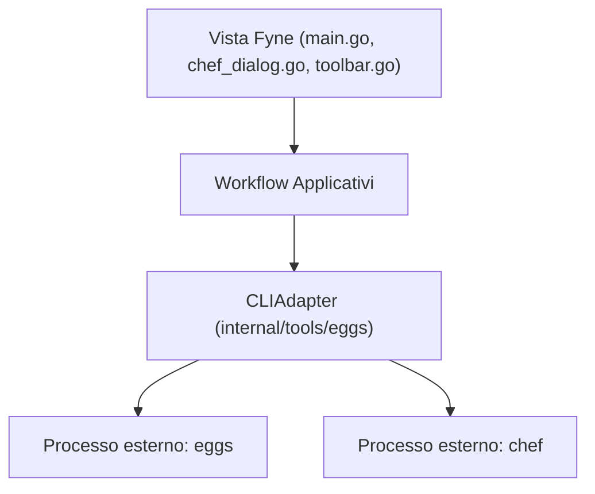

import Translactions from '@site/src/components/Translactions';

<Translactions />

# Architettura, requisiti e sviluppo

`penguins-gui` è progettata secondo una rigorosa separazione tra presentazione grafica e logica di dominio dei tool sottostanti.

---

## 🧩 Architettura a livelli

L'applicazione è organizzata in livelli distinti per garantire manutenibilità e testabilità:



1. **Livello di presentazione (Fyne):** Gestisce finestre, dialoghi, temi, zoom dei font e stato visivo. Tutte le mutazioni della UI avvengono in sicurezza sul thread grafico tramite `fyne.Do`, mentre le operazioni di lunga durata girano in goroutine asincrone senza mai bloccare la finestra.
2. **CLIAdapter (`internal/tools/eggs`):** Isola il rilevamento degli eseguibili in `PATH`, la costruzione degli argomenti CLI, l'elevazione dei privilegi per-processo (`pkexec`), la pulizia delle sequenze ANSI dallo stream di output e la ricerca dell'artefatto `.iso` generato.
3. **Confini di sicurezza (Polkit):** L'interfaccia grafica non gira mai come `root`. Include le regole PolicyKit (`49-penguins-gui.rules`) per richiedere l'autorizzazione amministrativa solo nel momento in cui viene lanciato un comando che modifica il sistema.

---

## 📋 Requisiti di sistema

- **Sistema operativo:** Distribuzione Linux con sessione grafica X11 o Wayland attiva.
- **Autenticazione:** Polkit (`pkexec`) o `sudo` per le operazioni amministrative.
- **Grafica:** Driver video con supporto OpenGL (richiesto dal toolkit Fyne) e `xorg-xrandr` su ambienti X11/Arch.
- **Dipendenze di utilità:** `curl` e `gpg` (per la configurazione automatica dei repository). I binari `eggs` e `chef` possono essere installati direttamente tramite la GUI.

---

## 💻 Compilazione da sorgente e pacchettizzazione

Il codice sorgente è ospitato nel repository ufficiale:  
👉 **[https://github.com/pieroproietti/penguins-gui](https://github.com/pieroproietti/penguins-gui)**

### Sviluppo locale
Per clonare, eseguire i test ed effettuare il run locale:
```bash
git clone https://github.com/pieroproietti/penguins-gui.git
cd penguins-gui
go mod tidy
go test ./...
go run .
```

### Generazione pacchetti nativi e AppImage
Il progetto include un sistema di build autonomo in Go (senza richiedere privilegi di root durante la creazione dei pacchetti) e il supporto per AppImage:
```bash
# Compila il binario penguins-gui
make build

# Genera i pacchetti nativi (.deb, .rpm, .pkg.tar.zst) nella cartella dist/
make package

# Genera il bundle portatile AppImage
make appimage
```
